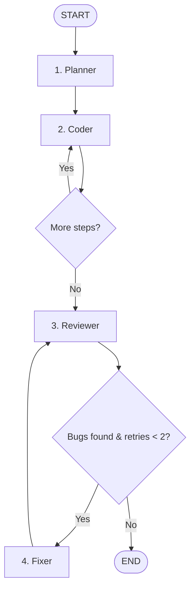

# Agentic AI Coding Assistant

An autonomous, multi-agent coding assistant built with **LangGraph**, **LangChain**, and **OpenAI GPT-4o**. The system takes a high-level natural language prompt, plans the codebase architecture, writes the implementation files directly to disk, and executes an iterative review-and-fix loop until all code meets quality requirements.

---

## Key Features

- **Automated Planning**: Deconstructs complex user prompts into step-by-step file generation tasks using structured outputs.
- **Direct Code Generation**: Writes clean, production-ready code directly to disk, automatically creating required directories and files.
- **Automated Code Review**: Reviews the generated codebase against user specifications for syntax errors, logic bugs, and missing features.
- **Self-Healing Loop**: Automatically patches and rewrites defective files based on specific reviewer feedback (up to 2 retries).
- **Stateful Graph Architecture**: Powered by LangGraph's cyclical state graph for transparent, robust execution flow.
- **Full Observability (LangSmith)**: Deep tracing of graph states, LLM prompts/responses, file I/O operations, token usage, and latency.

---

## Architecture & Workflow

The assistant operates as a cyclic state machine defined in `src/aiagent_coding_assistant/graph.py`:



### Node Responsibilities

| Node | Function | Description |
| :--- | :--- | :--- |
| **`planner`** | Task Decomposition | Takes the user's task prompt and produces a structured `Plan` consisting of sequential `Step` items (`file_path` and `instruction`). |
| **`coder`** | File Writer | Iterates through plan steps, invokes the LLM for raw code, creates parent directories if needed, and writes each file to disk. |
| **`reviewer`** | Quality Assurance | Gathers all generated files, inspects the codebase, and produces a structured `ReviewList` identifying any failures and actionable feedback. |
| **`fixer`** | Self-Correction | For each failed file, prompts the LLM with reviewer feedback, rewrites the file on disk, increments the retry count, and re-triggers the reviewer. |

---

## Project Structure

```text
AIAgent-coding_assistant/
|-- .env.example                       # Example environment variable configuration
|-- main.py                            # Interactive CLI entry point with LangSmith tagging
|-- pyproject.toml                     # Project packaging and metadata
|-- requirements.txt                   # Core Python dependencies (LangGraph, LangChain, LangSmith)
|-- src/
|   \-- aiagent_coding_assistant/
|       |-- __init__.py                # Package initialization
|       |-- graph.py                   # LangGraph state machine & edge definitions
|       |-- nodes.py                   # Node logic & @traceable file operations
|       \-- state.py                   # Pydantic schemas (Plan, Step, Review) & State TypedDict
|-- implementationplan.md              # LangSmith implementation roadmap
\-- README.md                          # Documentation
```

---

## Getting Started

### Prerequisites

- **Python 3.12+**
- An **OpenAI API Key** (with access to `gpt-4o`)
- A **LangSmith API Key** (optional, for observability and trace visualization)

### 1. Clone & Navigate to Repository

```bash
git clone <repository-url>
cd AIAgent-coding_assistant
```

### 2. Set Up a Virtual Environment

**On Windows (PowerShell):**
```powershell
python -m venv .venv
.\.venv\Scripts\Activate.ps1
```

**On Linux / macOS:**
```bash
python3 -m venv .venv
source .venv/bin/activate
```

### 3. Install Dependencies

Using `pip`:
```bash
pip install -r requirements.txt
```

*(Alternatively, if using `uv`: `uv pip install -r requirements.txt`)*

### 4. Configure Environment Variables

Copy `.env.example` to `.env`:

**On Windows (PowerShell):**
```powershell
Copy-Item .env.example .env
```

**On Linux / macOS:**
```bash
cp .env.example .env
```

Open `.env` and set your OpenAI credentials:
```env
OPENAI_API_KEY=your_actual_openai_api_key_here

# LangSmith Observability Configuration (Optional)
LANGSMITH_TRACING=false
LANGSMITH_ENDPOINT="https://api.smith.langchain.com"
LANGSMITH_API_KEY=lsv2_pt_your_api_key_here
LANGSMITH_PROJECT="aiagent-coding-assistant"
```

---

## Usage

Run the main application:

```bash
python main.py
```

When prompted:
```text
What would you like me to build?
> 
```

Provide your coding prompt. For example:
- *"Build a Python module in calc/math_ops.py with add, subtract, multiply, and divide functions, and corresponding unit tests in calc/test_math_ops.py."*
- *"Create a simple CLI todo application in Python with save/load functionality using JSON."*

The assistant will:
1. Break down the task into files to generate.
2. Generate each file and write it to disk.
3. Review all generated files.
4. Automatically fix any issues if defects are detected (up to 2 retry attempts).

---

## 🔍 Observability with LangSmith

LangSmith tracing is integrated into this project to provide deep visibility into the multi-agent graph:

1. Sign up at [smith.langchain.com](https://smith.langchain.com/) and create an API key in **Settings → API Keys**.
2. In `.env`, set:
   ```env
   LANGSMITH_TRACING=true
   LANGSMITH_API_KEY="lsv2_pt_..."
   LANGSMITH_PROJECT="aiagent-coding-assistant"
   ```
3. Run `python main.py`.
4. Open your dashboard at [smith.langchain.com](https://smith.langchain.com/) to view:
   - Complete execution trees of the `planner`, `coder`, `reviewer`, and `fixer` nodes.
   - Child tool spans for `write_file_to_disk` and `read_codebase`.
   - Exact prompts, system messages, and structured JSON outputs (`Plan`, `ReviewList`).
   - Token consumption, latency, and estimated cost per node.

---

## Configuration & Customization

- **Change the LLM Model**: Update `llm` in `src/aiagent_coding_assistant/nodes.py` (default: `gpt-4o`, temperature `0`).
- **Adjust Retry Limits**: Modify the retry threshold in `graph.add_conditional_edges` inside `src/aiagent_coding_assistant/graph.py`.
- **Add Pre/Post Steps**: Add custom nodes to the LangGraph graph in `src/aiagent_coding_assistant/graph.py` (e.g., automated test runners, linters, or human-in-the-loop approvals).

---

## License

This project is open-source and available under the standard MIT or project-specified license.
